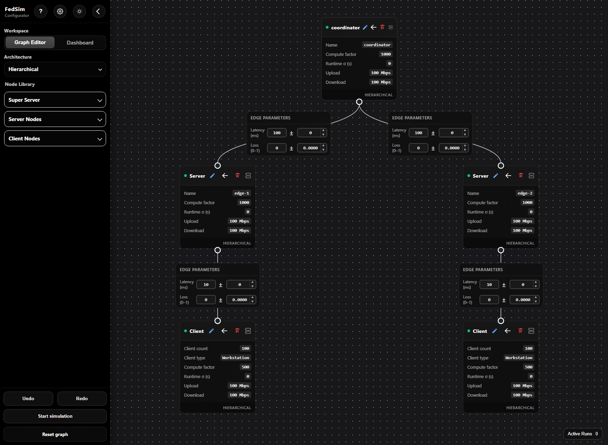
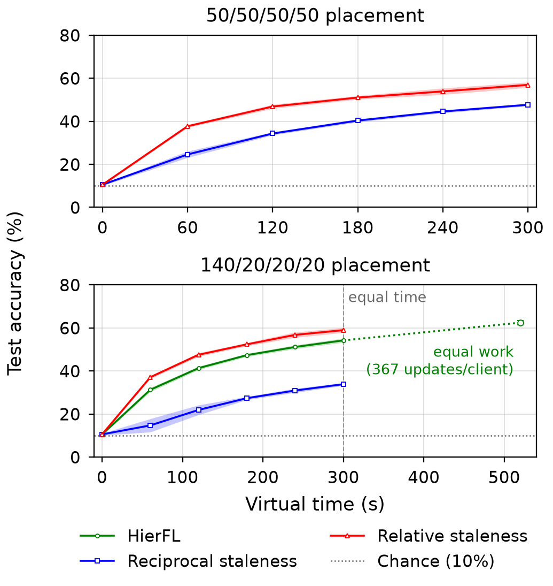

# FedSim

[](https://github.com/FedSim-Research/fedsim/actions/workflows/checks.yml)
[](LICENSE)
[](docs/development.md)
[](https://doi.org/10.5281/zenodo.24245352)

**Topology-aware simulation of geo-distributed federated learning.**

FedSim lets you draw a multi-server federated-learning deployment as a graph,
run it with real PyTorch training, and trace every result back to the
configuration and update rules that produced it. It includes a hierarchical
engine (HierFL) and a Spyker-inspired asynchronous multi-server engine.



## Features

- **Topology editor:** servers, client groups and per-link bandwidth, latency,
  jitter and packet loss, validated before a run starts.
- **Explicit update rules:** hierarchical aggregation, asynchronous blending
  with configurable staleness weighting and learning-rate feedback.
- **Virtual time, real training:** simulated compute and network delays on Ray,
  with thousands of logical clients sharing a fixed worker pool.
- **Reproducible runs:** immutable run definitions, per-server checkpoints,
  update traces, CSV export, and Grafana dashboards.

## Quick start

```bash
git clone https://github.com/FedSim-Research/fedsim.git
cd fedsim
docker compose up -d --build
```

Open **[localhost:8088](http://localhost:8088)**. The
[Getting started guide](docs/getting-started.md) walks through a first
simulation and lists all everyday commands.

## Key result

With 140 of 200 clients on one server, measuring staleness in waves of each
server's own clients instead of raw update counts raises CIFAR-10 accuracy from
33.9% to 59.0% at every one of five seeds, ahead of HierFL at equal virtual time.

<p align="center">
  
</p>

See the [paper and artifacts](#paper-and-citation) for methods, limitations and data.

## Documentation

| Guide | Contents |
| --- | --- |
| [Getting started](docs/getting-started.md) | Start FedSim, run a first simulation, everyday commands |
| [Development](docs/development.md) | Local installation, tests and frontend development |
| [Architecture](docs/architecture.md) | Engines, update rules, event kernel and delay models |
| [Experiments](docs/experiments.md) | Scripted, archived comparison campaigns |
| [Reproducibility](docs/reproducibility.md) | Random state, data assignment and evaluation scope |
| [Operations](docs/operations.md) | Configuration, storage, capacity and GPU deployment |

## Paper and citation

The accompanying paper, experiment archives, traces and checkpoints are on
Zenodo under [doi:10.5281/zenodo.24245352](https://doi.org/10.5281/zenodo.24245352).
To cite the software, use [CITATION.cff](CITATION.cff) or GitHub's
*Cite this repository* button, and record the commit you used.

## License

[Apache-2.0](LICENSE). Third-party components retain their own licenses; see
[Third-party notices](THIRD_PARTY_NOTICES.md).
