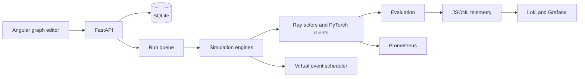

# Architecture

The Python application is one installable package, `fedsim`, under `src/`.
`api` defines HTTP routes and schemas, `persistence` stores graphs and run
records, and `services` validates topologies and manages queued simulations.

`engines.hierarchical` implements client, edge-server, and coordinator
aggregation. `engines.spyker` implements asynchronous training and exchanges
between peer servers. Both use the shared `clients`, `simulation`, `specs`,
and `strategies` modules. Ray executes actors; the event scheduler represents
virtual computation and communication delays.

`learning` contains the CNN and training/data helpers. `evaluation` provides
the shared evaluation loader and checkpoint evaluation. `telemetry` records
periodic metrics, which the API can persist and monitoring services can read.
Flower Datasets supplies dataset partitioning; Flower's simulation framework
is not involved in execution.

The frontend is a separate Angular application organized by feature. `editor`
owns the topology canvas, nodes, graph state, and editing controls. `runs` owns
simulation settings, job tracking, and result dashboards. `shell` contains the
workspace sidebar and help dialog; `api` contains HTTP access, shared transport
types, and error handling. Component templates, styles, and tests live alongside
their TypeScript source.

`deploy/` holds container, reverse-proxy, and monitoring configuration. Root
Compose files assemble these components and mount a shared runtime directory;
runtime state is not source code.

The editor keeps serializable graph state separate from ngx-vflow's signal-based
render models. `FlowRenderer` preserves render-model identity by node or edge ID
while reconciling data changes, so edits and history updates do not reset an
in-progress drag.

## Training settings and virtual time

Both engines pass the selected dataset ID to their training clients. The batch
size, epochs, and learning rate reach each training task; changing the batch
size preserves the data loader's seeded random generator.

The compute factor scales nominal training time as
`dataset_size * epochs * model_complexity / compute_factor`. The editor's
`performanceSigma` is the standard deviation of additive, zero-mean Gaussian
runtime noise in **virtual seconds**, independent of the compute factor.
Missing or null sigma values default to zero. Zero adds no noise and consumes
no random draw. Durations are floored at `1e-6` seconds. Compute factors must be
finite and positive; sigma must be finite and nonnegative.
Clipping at this floor can raise the mean effective duration above nominal
training time, especially when sigma is large relative to that time.

Model transfer time uses the sender's upload and the receiver's download
bandwidth. Client uploads therefore use the client as sender and its server as
receiver. Both directions currently use the same link latency and loss model.

The aggregation-time helper uses the same zero-mean noise convention. Its
delay is currently not scheduled by either engine. These corrections change
effective settings and virtual timings; historical results must retain their
original code and configuration rather than being relabeled as new results.
