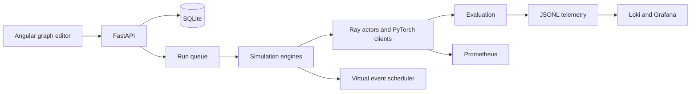

# Architecture

The Python application is one installable package, `fedsim`, under `src/`.
`api` defines HTTP routes and schemas, `persistence` stores graphs and run
records, and `services` validates topologies and manages queued simulations.

`engines.hierarchical` implements client, edge-server, and coordinator
aggregation. `engines.spyker` implements asynchronous training and exchanges
between peer servers. Both use the shared `clients`, `simulation`, `specs`,
and `strategies` modules. Ray executes actors; the event scheduler represents
virtual computation and communication delays.

`learning` contains the CNN and training/data helpers. `evaluation` provides
the shared evaluation loader and checkpoint evaluation. `telemetry` records
periodic metrics, which the API can persist and monitoring services can read.
Flower Datasets supplies dataset partitioning; Flower's simulation framework
is not involved in execution.

The frontend is a separate Angular application organized by feature. `editor`
owns the topology canvas, nodes, graph state, and editing controls. `runs` owns
simulation settings, job tracking, and result dashboards. `shell` contains the
workspace sidebar and help dialog; `api` contains HTTP access, shared transport
types, and error handling. Component templates, styles, and tests live alongside
their TypeScript source.

`deploy/` holds container, reverse-proxy, and monitoring configuration. Root
Compose files assemble these components and mount a shared runtime directory;
runtime state is not source code.

The editor keeps serializable graph state separate from ngx-vflow's signal-based
render models. `FlowRenderer` preserves render-model identity by node or edge ID
while reconciling data changes, so edits and history updates do not reset an
in-progress drag.

## Captured run definitions

After preflight validation, the API captures the exact graph objects and
normalized settings into an immutable JSON definition. Nodes and edges retain
their captured list order because server registration, token order, and client
partition assignment depend on it. JSON object keys are canonicalized; schema
version 1 and the complete captured input are covered by a SHA-256 checksum.
This is a content checksum, not a signature or a complete environment record.

The queue archives the definition before accepting a job. Execution creates
independent transient graph objects from that definition; it never reloads
the editor graph. Both mode captures both topologies in one definition. Runtime
GPU budget scaling changes an execution copy, while the requested definition
stays unchanged. Per-repetition results record the simulation settings passed
to the controller; these are not measurements of actual resource usage.

Queued responses and final run metadata include the definition and checksum;
the existing CSV metadata field preserves them. The JSON export reads the
archive independently of the in-memory queue. Historical records without a
captured definition remain readable and have no invented snapshot.

## Runtime lifecycle

Managed controllers register their use of Ray before dataset preload and keep
that registration through training, checkpoint saving, and final evaluation.
The runtime initializes lazily. Registration, initialization, and final shutdown
share one lock; shutdown cannot use a stale zero-user decision while another
caller registers. Explicit `shutdown_ray()` rejects active managed users.

Both mode holds an additional registration for each seed pair, including the
GPU capacity probe and the completion of both executor futures. An engine
failure therefore waits for its partner to exit before releasing the runtime.
Each finished pair releases its registration before the next seed starts.
When no other managed callers remain, Ray shuts down between pairs. This
coordination applies within the driver process; direct `ray.shutdown()` calls
outside FedSim bypass it.

## CPU execution

Coordination, dataset, evaluator, and client actors explicitly request zero
logical CPUs. Keeping these actors alive therefore cannot consume the CPU
reservations needed to start training. Each client retains its model, data
loaders, and random generator between callbacks.

Both engines submit `START_FIT` and periodic `EVALUATE` callbacks through one
named CPU execution pool per Ray namespace. The pool creates one worker per
whole CPU available when it is first built. Each worker reserves one logical
CPU for its lifetime and waits for one compute callback to finish before
accepting another. Initial periodic evaluation also uses the pool. Concurrent
engine controllers share the same capacity, including in Both mode. Client
and periodic evaluator actors set PyTorch's intra-op thread count to one.

This bounds active training and periodic evaluation callbacks, not total
process count, memory, or operating-system CPU usage. Client initialization,
server aggregation, data preparation, and the controller's final evaluation
run outside this admission pool. Idle clients still retain their own processes
and training state. CPU reservations last for the pool's lifetime; shutting
down its owning Ray job releases the pool.

Changing execution concurrency can change callback completion order and thus
event tie-breaking. Virtual delay formulas are unchanged; bitwise equivalence
with previous runs is not guaranteed.

## Training settings and virtual time

Both engines initialize their shared model from the run seed with a private
CPU PyTorch generator. Model construction uses meta tensors before allocating
and initializing weights, so it does not consume or reseed the process-global
generator. The layer shapes and default Conv2d/Linear initialization are
unchanged. Controllers and training clients no longer seed global Python,
NumPy, or PyTorch state.
Before allocating weights, model construction verifies that its explicit
initializer covers every registered parameter and that no buffers would be
left uninitialized. Extensions with additional state fail until their
initialization is defined.

Server actors receive the run seed through their simulation context. Their
network streams are scoped by server ID and destination ID. Client actors use
their existing per-client seed (run seed plus partition index), with separate
streams for training duration, downloads, and uploads per server. Streams
advance independently and remain owned by the actor between callbacks. The
`fedsim-rng-v1` scheme derives 64-bit seeds from canonical JSON using SHA-256,
independently of Python's randomized hash. Unseeded runs use private generators
initialized from system entropy.

Both engines pass the selected dataset ID to their training clients. The batch
size, epochs, and learning rate reach each training task; changing the batch
size preserves the data loader's seeded random generator.

The compute factor scales nominal training time as
`dataset_size * epochs * model_complexity / compute_factor`. The editor's
`performanceSigma` is the standard deviation of additive, zero-mean Gaussian
runtime noise in **virtual seconds**, independent of the compute factor.
Missing or null sigma values default to zero. Zero adds no noise and consumes
no random draw. Durations are floored at `1e-6` seconds. Compute factors must be
finite and positive; sigma must be finite and nonnegative.
Clipping at this floor can raise the mean effective duration above nominal
training time, especially when sigma is large relative to that time.

Model transfer time uses the sender's upload and the receiver's download
bandwidth. Client uploads therefore use the client as sender and its server as
receiver. Both directions currently use the same link latency and loss model.
Payload sizes are counted in bytes; bandwidth is decimal Mbps (one million
bits per second). The serialization term is `8 * payload_bytes / (Mbps * 1_000_000)`,
using the effective bottleneck throughput after the existing loss adjustment.
Model payloads count NumPy tensor bytes and exclude message metadata, framing,
and Ray serialization overhead. Spyker control messages use an estimated
1,000-byte payload. An empty model has zero tensor bytes; link latency still
applies. This corrects the former mixing of MiB sizes with decimal Mbps.

The aggregation-time helper uses the same zero-mean noise convention. Its
delay is currently not scheduled by either engine. These corrections change
effective settings and virtual timings; historical results must retain their
original code and configuration rather than being relabeled as new results.

## Spyker peer synchronization

Multi-server Spyker graphs require a direct link between every pair of servers.
The editor and backend reject incomplete meshes; the engine also checks this
before starting Ray. A single server is supported without a token successor
or peer synchronization. Self-links do not add synchronization participants.
The first registered server starts with the token. The ring follows the engine's
server registration order (`server_ids`) and wraps from the last server to the
first.

Following [Spyker Algorithm 2](https://arxiv.org/pdf/2406.01439v2), each server
broadcasts its current model once per synchronization ID, before aggregating
the first incoming peer model. It then aggregates one contribution from each
distinct peer, including at the initiating server. Broadcast-once tracking does
not suppress other peers' contributions. Client training continues while the
server exchange is in progress.

The initiator releases the token only after aggregating every peer's response.
Duplicate, self-originated, and unknown-sender model messages cannot complete
the round. IDs use an increasing counter per initiating actor, independently
of model age. The duplicate cache retains up to 1,000 recent rounds and protects
the active round from eviction; arbitrarily old duplicates are not covered.

The existing model-weighting formula, integer monotonic model ages, and token
circulation policy are retained. Peer aggregation remains asynchronous and
can depend on arrival order. These protocol corrections do not establish full
equivalence with the original Spyker implementation or validate paper results.
The scheduler assigns tie-breaking sequence IDs when callbacks complete.
Fixed seeds therefore do not by themselves guarantee identical event order
across runs.
