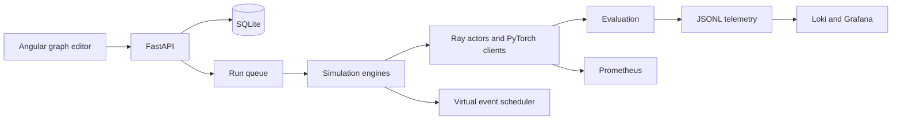

# Architecture

The Python application is one installable package, `fedsim`, under `src/`.
`api` defines HTTP routes and schemas, `persistence` stores graphs and run
records, and `services` validates topologies and manages queued simulations.

`engines.hierarchical` implements client, edge-server, and coordinator
aggregation. `engines.spyker` implements asynchronous training and exchanges
between peer servers. Both use the shared `clients`, `simulation`, `specs`,
and `strategies` modules. Ray executes actors; the event scheduler represents
virtual computation and communication delays.

`learning` contains the CNN and training/data helpers. `evaluation` provides
the shared evaluation loader and checkpoint evaluation. `telemetry` records
periodic metrics, which the API can persist and monitoring services can read.
Flower Datasets supplies dataset partitioning; Flower's simulation framework
is not involved in execution.

The frontend is a separate Angular application organized by feature. `editor`
owns the topology canvas, nodes, graph state, and editing controls. `runs` owns
simulation settings, job tracking, and result dashboards. `shell` contains the
workspace sidebar and help dialog; `api` contains HTTP access, shared transport
types, and error handling. Component templates, styles, and tests live alongside
their TypeScript source.

`deploy/` holds container, reverse-proxy, and monitoring configuration. Root
Compose files assemble these components and mount a shared runtime directory;
runtime state is not source code.

The editor keeps serializable graph state separate from ngx-vflow's signal-based
render models. `FlowRenderer` preserves render-model identity by node or edge ID
while reconciling data changes, so edits and history updates do not reset an
in-progress drag.

## CPU execution

Coordination, dataset, evaluator, and client actors explicitly request zero
logical CPUs. Keeping these actors alive therefore cannot consume the CPU
reservations needed to start training. Each client retains its model, data
loaders, and random generator between callbacks.

Both engines submit `START_FIT` and periodic `EVALUATE` callbacks through one
named CPU execution pool per Ray namespace. The pool creates one worker per
whole CPU available when it is first built. Each worker reserves one logical
CPU for its lifetime and waits for one compute callback to finish before
accepting another. Initial periodic evaluation also uses the pool. Concurrent
engine controllers share the same capacity, including in Both mode. Client
and periodic evaluator actors set PyTorch's intra-op thread count to one.

This bounds active training and periodic evaluation callbacks, not total
process count, memory, or operating-system CPU usage. Client initialization,
server aggregation, data preparation, and the controller's final evaluation
run outside this admission pool. Idle clients still retain their own processes
and training state. CPU reservations last for the pool's lifetime; shutting
down its owning Ray job releases the pool.

Changing execution concurrency can change callback completion order and thus
event tie-breaking. Virtual delay formulas are unchanged; bitwise equivalence
with previous runs is not guaranteed.

## Training settings and virtual time

Both engines pass the selected dataset ID to their training clients. The batch
size, epochs, and learning rate reach each training task; changing the batch
size preserves the data loader's seeded random generator.

The compute factor scales nominal training time as
`dataset_size * epochs * model_complexity / compute_factor`. The editor's
`performanceSigma` is the standard deviation of additive, zero-mean Gaussian
runtime noise in **virtual seconds**, independent of the compute factor.
Missing or null sigma values default to zero. Zero adds no noise and consumes
no random draw. Durations are floored at `1e-6` seconds. Compute factors must be
finite and positive; sigma must be finite and nonnegative.
Clipping at this floor can raise the mean effective duration above nominal
training time, especially when sigma is large relative to that time.

Model transfer time uses the sender's upload and the receiver's download
bandwidth. Client uploads therefore use the client as sender and its server as
receiver. Both directions currently use the same link latency and loss model.

The aggregation-time helper uses the same zero-mean noise convention. Its
delay is currently not scheduled by either engine. These corrections change
effective settings and virtual timings; historical results must retain their
original code and configuration rather than being relabeled as new results.

## Spyker peer synchronization

Multi-server Spyker graphs require a direct link between every pair of servers.
The editor and backend reject incomplete meshes; the engine also checks this
before starting Ray. A single server is supported without a token successor
or peer synchronization. Self-links do not add synchronization participants.
The first registered server starts with the token. The ring follows the engine's
server registration order (`server_ids`) and wraps from the last server to the
first.

Following [Spyker Algorithm 2](https://arxiv.org/pdf/2406.01439v2), each server
broadcasts its current model once per synchronization ID, before aggregating
the first incoming peer model. It then aggregates one contribution from each
distinct peer, including at the initiating server. Broadcast-once tracking does
not suppress other peers' contributions. Client training continues while the
server exchange is in progress.

The initiator releases the token only after aggregating every peer's response.
Duplicate, self-originated, and unknown-sender model messages cannot complete
the round. IDs use an increasing counter per initiating actor, independently
of model age. The duplicate cache retains up to 1,000 recent rounds and protects
the active round from eviction; arbitrarily old duplicates are not covered.

The existing model-weighting formula, integer monotonic model ages, and token
circulation policy are retained. Peer aggregation remains asynchronous and
can depend on arrival order. These protocol corrections do not establish full
equivalence with the original Spyker implementation or validate paper results.
The scheduler assigns tie-breaking sequence IDs when callbacks complete.
Fixed seeds therefore do not by themselves guarantee identical event order
across runs.
