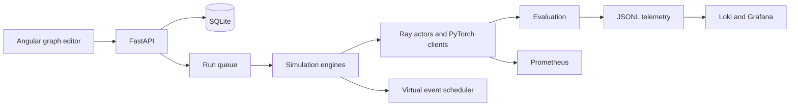

# Architecture

The Python application is one installable package, `fedsim`, under `src/`.
`api` defines HTTP routes and schemas, `persistence` stores graphs and run
records, and `services` validates topologies and manages queued simulations.

`engines.hierarchical` implements client, edge-server, and coordinator
aggregation. `engines.spyker` implements asynchronous training and exchanges
between peer servers. Both use the shared `clients`, `simulation`, `specs`,
and `strategies` modules. Ray executes actors; the event scheduler represents
virtual computation and communication delays.

`learning` contains the CNN and training/data helpers. `evaluation` provides
the shared evaluation loader and checkpoint evaluation. `telemetry` records
periodic metrics, which the API can persist and monitoring services can read.
Flower Datasets supplies dataset partitioning; Flower's simulation framework
is not involved in execution.

The frontend is a separate Angular application organized by feature. `editor`
owns the topology canvas, nodes, graph state, and editing controls. `runs` owns
simulation settings, job tracking, and result dashboards. `shell` contains the
workspace sidebar and help dialog; `api` contains HTTP access, shared transport
types, and error handling. Component templates, styles, and tests live alongside
their TypeScript source.

`deploy/` holds container, reverse-proxy, and monitoring configuration. Root
Compose files assemble these components and mount a shared runtime directory;
runtime state is not source code.

The editor keeps serializable graph state separate from ngx-vflow's signal-based
render models. `FlowRenderer` preserves render-model identity by node or edge ID
while reconciling data changes, so edits and history updates do not reset an
in-progress drag.

## Captured run definitions

After preflight validation, the API captures the exact graph objects and
normalized settings into an immutable JSON definition. Nodes and edges retain
their captured list order because server registration, token order, and client
partition assignment depend on it. JSON object keys are canonicalized; schema
version 1 and the complete captured input are covered by a SHA-256 checksum.
This is a content checksum, not a signature or a complete environment record.

The queue archives the definition before accepting a job. Execution creates
independent transient graph objects from that definition; it never reloads
the editor graph. Both mode captures both topologies in one definition. Runtime
GPU budget scaling changes an execution copy, while the requested definition
stays unchanged. Per-repetition results record the simulation settings passed
to the controller; these are not measurements of actual resource usage.

Queued responses and final run metadata include the definition and checksum;
the existing CSV metadata field preserves them. The JSON export reads the
archive independently of the in-memory queue. Historical records without a
captured definition remain readable and have no invented snapshot.

## Dataset assignments

Each engine creates its dataset provider from the driver and passes the handle
through the simulation context to its clients. Providers are named by Ray job
and the `fedsim-iid-v1` definition: normalized dataset ID, partition count, and
run seed (42 when omitted). Atomic `get_if_exists` creation lets matching Both
controllers share one provider in the same Ray namespace and job. Providers
use ordinary, non-detached lifetimes; they do not outlive their owning Ray job
or share ownership across unrelated jobs.

Flower Datasets explicitly shuffles the source data with the common run seed
before IID partitioning. Each partition has a deterministic 80/20 train/test
split, with its seed derived from the run seed and partition index. Splits are
created on demand and cached once per partition. Client shuffle seeds remain
run seed plus client index and affect batch order independently of membership.
Changing the client shuffle seed cannot create another full partition set.

Matching dataset contents, partition counts, and run seeds therefore give the
same assignment by partition index in both engines. Mapping those indices to
topology nodes follows captured client registration order. Dataset revisions
are not automatically pinned or archived; experiments must still record the
actual dataset revision and index-to-client mapping. Direct `load_data` callers
can provide `partition_seed` separately from the loader shuffle `seed`; omitted
partition seeds use 42.

## Runtime lifecycle

Managed controllers register their use of Ray before dataset preload and keep
that registration through training, checkpoint saving, and final evaluation.
The runtime initializes lazily. Registration, initialization, and final shutdown
share one lock; shutdown cannot use a stale zero-user decision while another
caller registers. Explicit `shutdown_ray()` rejects active managed users.

Both mode holds an additional registration for each seed pair, including the
GPU capacity probe and the completion of both executor futures. An engine
failure therefore waits for its partner to exit before releasing the runtime.
Each finished pair releases its registration before the next seed starts.
When no other managed callers remain, Ray shuts down between pairs. This
coordination applies within the driver process; direct `ray.shutdown()` calls
outside FedSim bypass it.

## CPU execution

Coordination, dataset, and evaluator actors explicitly request zero logical
CPUs. Clients are logical addresses, not separate Ray processes. Each CPU
worker owns persistent client instances, including each client's data loaders,
shuffle generator and independent timing streams. A worker resolves each
execution's immutable context once instead of deserializing the complete client
registry separately for every client. Execution identities separate concurrent
runs even when their client IDs match.

The worker reuses one CNN across its serialized training calls. Every call
loads all server-supplied parameters and creates a fresh SGD optimizer, so
neither model parameters nor optimizer momentum persist as client-local state
in the current protocol. Loader and timing states remain private to each
client. Tests compare interleaved runs against independently instantiated
models with exact weight and loss equality. A future algorithm requiring
persistent local model or optimizer state must extend this contract before
using the shared-model path.

Both engines submit `START_FIT` and periodic `EVALUATE` callbacks through one
named CPU execution pool per Ray namespace. The pool creates one worker per
whole CPU available when it is first built. Each worker reserves one logical
CPU for its lifetime and executes one compute callback at a time. Logical
clients are assigned by partition index modulo the worker count, preserving
their state between calls without serialization of PyTorch data loaders.
Initial and periodic evaluation use the same worker locks, so concurrent
engine controllers share the same capacity, including in Both mode. Clients
and periodic evaluator actors set PyTorch's intra-op thread count to one.

Each build receives a unique execution identity for worker-cache ownership;
this identity is not used in scientific seeds. Contexts are object-store
references, resolved once per logical client and retained as instance state.
The controller releases clients after execution, including failure paths,
without releasing another controller's clients. Release drains active work
and rejects queued or future work from that execution. Direct engine users
must call `close()` in a `finally` block before discarding the simulation.

Physical client execution processes therefore scale with available CPUs,
while loader state still grows with the number of clients. Model storage is
per worker and context storage per worker/execution. This removes per-client
interpreter/import and model-copy overhead; it does not make memory use
constant or guarantee a particular supported client count. Fixed client
affinity can leave a worker busier than another in heterogeneous workloads.

This bounds active client initialization, training and periodic evaluation,
not total memory or operating-system CPU usage. Coordination actors still
allocate processes, and server aggregation, dataset-provider preparation and
the controller's final evaluation run outside this pool. Idle clients retain
training state inside their worker. CPU reservations last for the pool's
lifetime; shutting down its owning Ray job releases the pool.

Changing execution concurrency can change callback completion order and thus
event tie-breaking. Virtual delay formulas are unchanged; bitwise equivalence
with previous runs is not guaranteed.

## Training settings and virtual time

Both engines initialize their shared model from the run seed with a private
CPU PyTorch generator. Model construction uses meta tensors before allocating
and initializing weights, so it does not consume or reseed the process-global
generator. The layer shapes and default Conv2d/Linear initialization are
unchanged. Controllers and training clients no longer seed global Python,
NumPy, or PyTorch state.
Before allocating weights, model construction verifies that its explicit
initializer covers every registered parameter and that no buffers would be
left uninitialized. Extensions with additional state fail until their
initialization is defined.

Server actors receive the run seed through their simulation context. Their
network streams are scoped by server ID and destination ID. Logical clients use
their existing per-client seed (run seed plus partition index), with separate
streams for training duration, downloads, and uploads per server. Streams
advance independently and remain owned by their client between callbacks. The
`fedsim-rng-v1` scheme derives 64-bit seeds from canonical JSON using SHA-256,
independently of Python's randomized hash. Unseeded runs use private generators
initialized from system entropy.

Both engines pass the selected dataset ID to their training clients. The batch
size, epochs, and learning rate reach each training task; changing the batch
size preserves the data loader's seeded random generator.

The compute factor scales nominal training time as
`dataset_size * epochs * model_complexity / compute_factor`. The editor's
`performanceSigma` is the standard deviation of additive, zero-mean Gaussian
runtime noise in **virtual seconds**, independent of the compute factor.
Missing or null sigma values default to zero. Zero adds no noise and consumes
no random draw. Durations are floored at `1e-6` seconds. Compute factors must be
finite and positive; sigma must be finite and nonnegative.
Clipping at this floor can raise the mean effective duration above nominal
training time, especially when sigma is large relative to that time.

Model transfer time uses the sender's upload and the receiver's download
bandwidth. Client uploads therefore use the client as sender and its server as
receiver. Both directions currently use the same link latency and loss model.
Payload sizes are counted in bytes; bandwidth is decimal Mbps (one million
bits per second). The serialization term is `8 * payload_bytes / (Mbps * 1_000_000)`,
using the effective bottleneck throughput after the existing loss adjustment.
Model payloads count NumPy tensor bytes and exclude message metadata, framing,
and Ray serialization overhead. Spyker control messages use an estimated
1,000-byte payload. An empty model has zero tensor bytes; link latency still
applies. This corrects the former mixing of MiB sizes with decimal Mbps.

Loss is a fraction and reduces effective throughput; individual packets and
retransmission state are not simulated. The API retains `tcp_rto_delay` for
compatibility with existing records, but neither engine reads it. The start
dialog therefore does not expose it as a tunable simulation control.

The aggregation-time helper uses the same zero-mean noise convention. Its
delay is currently not scheduled by either engine. These corrections change
effective settings and virtual timings; historical results must retain their
original code and configuration rather than being relabeled as new results.

## Model evaluation

HierFL evaluates the coordinator model. Spyker evaluates every registered
server on the same loaded test dataset and reports each server's accuracy and
loss. Its summary is an equal-weight mean of server metrics, identified as
`server_macro_mean`; model parameters and predictions are not averaged.
Loss is summed over examples and divided by the number actually evaluated,
so a partial last batch does not receive disproportionate weight.

Periodic evaluation requests snapshots from all target actors before running
the test loop. Each actor returns weights, progress metrics and its current
virtual time in one method call. This keeps each actor's snapshot internally
consistent; it is not an atomic cross-server barrier. Equal-time event order
can still affect which updates a snapshot includes.

One periodic database row retains the summary at each evaluation time. Its
existing `server_stats` JSON includes server-ID-keyed metrics, model ages,
snapshot times and raw progress. The summary's round is the minimum peer
model age, explicitly labeled as such, not a global synchronization round.
JSONL and Loki synchronization retain the server details; Loki reconstruction
also accepts historical text logs. No database schema migration is required.

Final Spyker saving writes one checkpoint per server. The requested filename
remains the first registered server's model; the other files use safe ordinal
suffixes such as `.server-2`. `primary_server_id` and `server_checkpoints` map
files to server IDs. When final evaluation is enabled, all files are evaluated
on one test loader. API responses and CSV result JSON preserve the mapping and
individual metrics for every repetition. The requested primary checkpoint is
not a model representing the summary mean.

The dashboard distinguishes recorded-model results from server means and
shows final per-server values by seed and repetition, including duplicate
seeds. Multi-seed summaries average the evaluated repetition summaries; Both
mode displays architecture results separately. Grafana trends filter by
architecture and extract only the fields needed for each summary metric.
Historical records without server details remain readable and gain no invented
server identities or aggregation semantics.

## Completed-run monitoring identities

One queued job can contain multiple seeded repetitions. Evaluation rows retain
their exact repetition IDs, while the job record stores those IDs in its result.
Parent-job selectors expand to that recorded set; an exact repetition selector
can inspect one run. No prefix inference or averaging across repetitions is used.
The CSV/raw-point export, archived chart reader and Loki sync share this mapping.
Loki accepts repetition points without inventing separate job records and keeps
the original repetition ID in stream labels. Parsed timestamps are normalized to
UTC; SQLite timestamps without an offset follow the same UTC convention.

The terminal snapshot is persisted before its in-memory status is published.
Persistence errors retain the existing logged, best-effort behavior. These paths
cover completed-run data; they do not establish live streaming or crash recovery.

## Spyker peer synchronization

Multi-server Spyker graphs require a direct link between every pair of servers.
The editor and backend reject incomplete meshes; the engine also checks this
before starting Ray. A single server is supported without a token successor
or peer synchronization. Self-links do not add synchronization participants.
The first registered server starts with the token. The ring follows the engine's
server registration order (`server_ids`) and wraps from the last server to the
first.

Following [Spyker Algorithm 2](https://arxiv.org/pdf/2406.01439v2), each server
broadcasts its current model once per synchronization ID, before aggregating
the first incoming peer model. It then aggregates one contribution from each
distinct peer, including at the initiating server. Broadcast-once tracking does
not suppress other peers' contributions. Client training continues while the
server exchange is in progress.

The initiator releases the token only after aggregating every peer's response.
Duplicate, self-originated, and unknown-sender model messages cannot complete
the round. IDs use an increasing counter per initiating actor, independently
of model age. The duplicate cache retains up to 1,000 recent rounds and protects
the active round from eviction; arbitrarily old duplicates are not covered.

The existing model-weighting formula, integer monotonic model ages, and token
circulation policy are retained. Peer aggregation remains asynchronous and
can depend on arrival order. These protocol corrections do not establish full
equivalence with the original Spyker implementation or validate paper results.
The scheduler assigns tie-breaking sequence IDs when callbacks complete.
Fixed seeds therefore do not by themselves guarantee identical event order
across runs.
